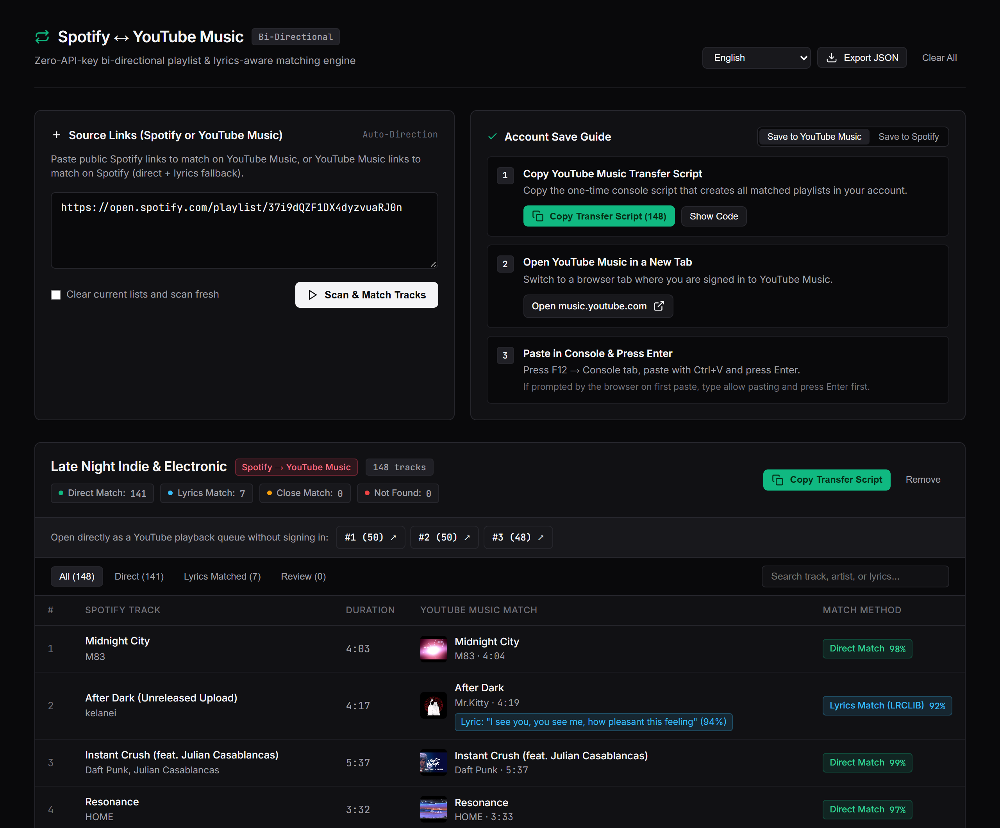

# spotify-youtube-music-transfer

[English](../../README.md) · [Türkçe](README.tr.md) · [Español](README.es.md) · [中文 (简体)](README.zh.md) · [हिन्दी](README.hi.md) · [العربية](README.ar.md) · [Português](README.pt.md) · [Русский](README.ru.md) · [日本語](README.ja.md) · [Deutsch](README.de.md) · [Français](README.fr.md) · [한국어](README.ko.md) · [Italiano](README.it.md) · [Bahasa Indonesia](README.id.md) · [Tiếng Việt](README.vi.md) · [Polski](README.pl.md) · [Українська](README.uk.md) · [Nederlands](README.nl.md) · **ไทย** · [Svenska](README.sv.md)

เครื่องมือย้ายเพลย์ลิสต์สองทิศทางและจับคู่ด้วยเนื้อเพลงโดยไม่ต้องใช้ API Key

วางลิงก์ Spotify เพื่อค้นหาใน YouTube Music หรือวางลิงก์ YouTube Music เพื่อค้นหาใน Spotify



## Quick Start

- **Windows (.exe):** [https://github.com/Myusufbasci/spotify-youtube-music-transfer/releases/latest](https://github.com/Myusufbasci/spotify-youtube-music-transfer/releases/latest) → `Spotify-YouTube-Music-Transfer.exe`
- **Windows (Script):** `Start-Windows.bat`
- **macOS / Linux:** `start-mac-linux.command`

```bash
git clone https://github.com/Myusufbasci/spotify-youtube-music-transfer.git
cd spotify-youtube-music-transfer

pip install -r requirements.txt
python app.py --web --open --port 5050
```

## คู่มือการบันทึกเข้าบัญชี

### บันทึกไปยัง YouTube Music
1. **คัดลอกสคริปต์โอนย้าย YouTube Music** — คัดลอกสคริปต์คอนโซลเพื่อสร้างเพลย์ลิสต์ทั้งหมดในบัญชีของคุณ
2. **เปิด YouTube Music ในแท็บใหม่** — สลับไปยังแท็บที่คุณเข้าสู่ระบบ YouTube Music ไว้
3. **วางใน Console แล้วกด Enter** — กด F12 → แท็บ Console วางด้วย Ctrl+V แล้วกด Enter (หากเบราว์เซอร์ถามสิทธิ์ในการวางครั้งแรก ให้พิมพ์ allow pasting แล้วกด Enter ก่อน)

### บันทึกไปยัง Spotify
1. **คัดลอกลิงก์เพลง Spotify** — แอป Spotify รองรับการวางลิงก์เพลงที่คัดลอกไว้ลงในเพลย์ลิสต์ได้โดยตรง
2. **เปิดเพลย์ลิสต์ว่างใน Spotify แล้วกด Ctrl+V** — สร้างเพลย์ลิสต์ใหม่ใน Spotify คลิกด้านในรายการแล้วกด Ctrl+V

## License

MIT
